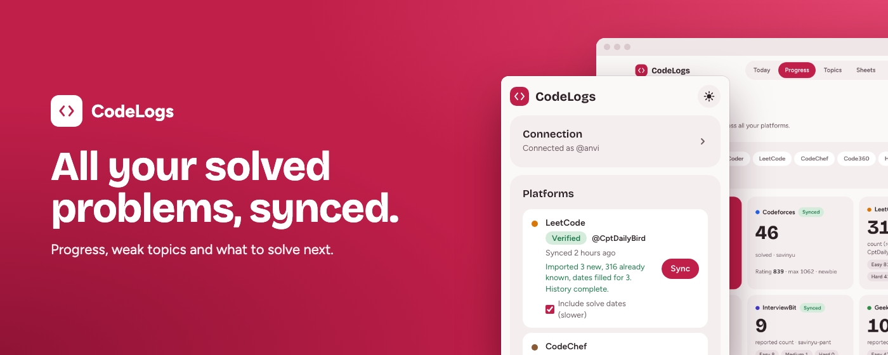
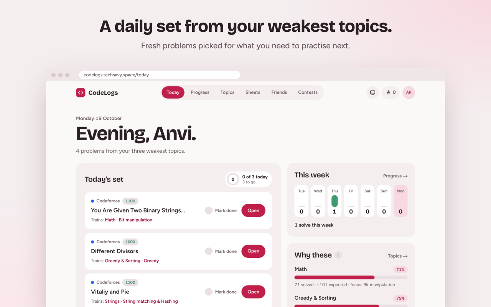
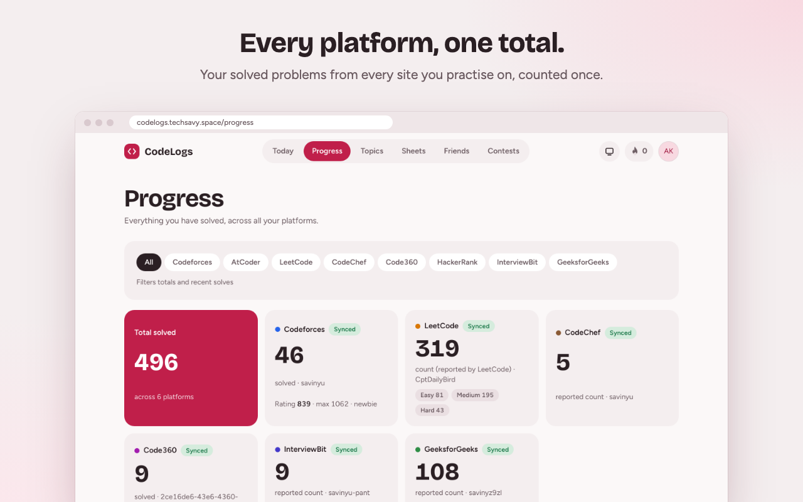
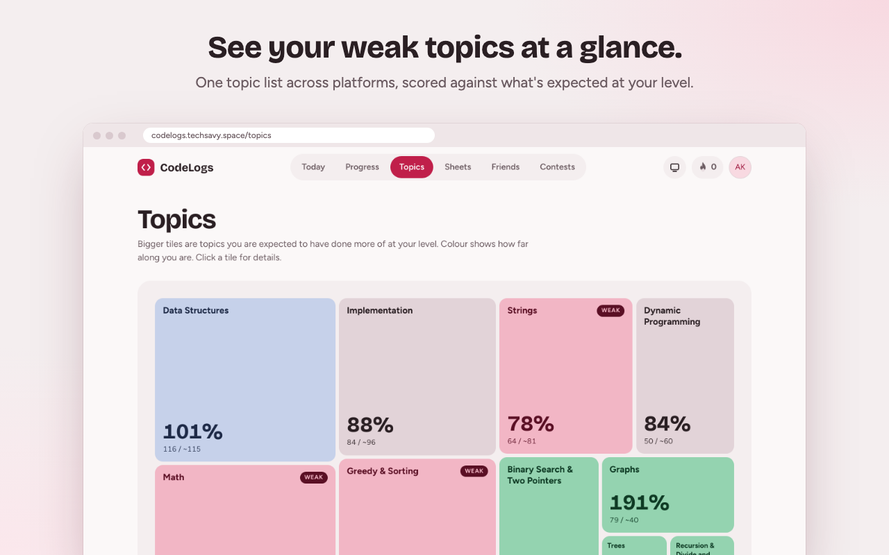
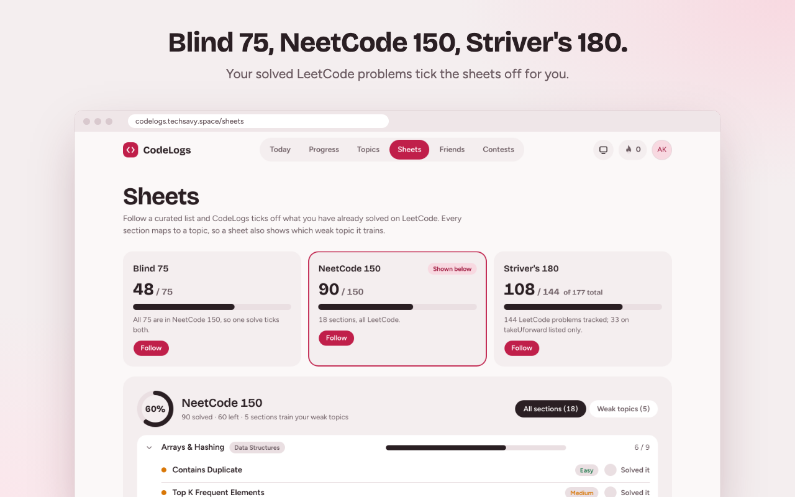
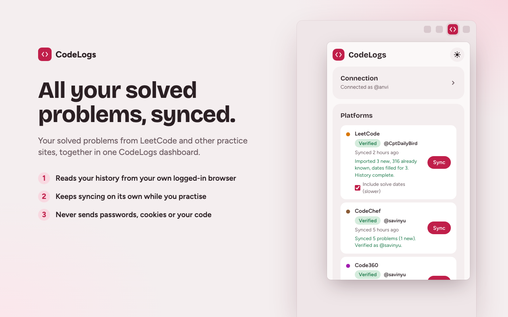

# CodeLogs



**All your solved problems in one place.** CodeLogs pulls your solves from **Codeforces, AtCoder and LeetCode**, plus **CodeChef, Code360, HackerRank, InterviewBit and GeeksforGeeks** through its browser extension. It maps them onto one topic list, shows where you're behind, and picks what to solve next.

**Live at [codelogs.techsavy.space](https://codelogs.techsavy.space)**: sign in with GitHub or Google.

## Why

If you practise on more than one site, your progress is split across profiles that don't agree on anything. Codeforces tags a problem `dp`, LeetCode says `dynamic-programming`, AtCoder has no tags at all, and each site has its own difficulty scale. Most trackers add up totals and ratings, but they don't tell you which topics you're behind on.

CodeLogs maps every platform's tags onto **one topic list** (10 topics, 40 subtopics), scores each topic against what someone at your level would be expected to have solved, and recommends **unsolved** problems at the right difficulty for your weakest topics.

## A tour

| **Today**: a daily set from your weakest topics | **Progress**: every platform, one total |
| :---: | :---: |
|  |  |
| **Topics**: your weak topics at a glance | **Sheets**: Blind 75, NeetCode 150, Striver's 180 |
|  |  |

- **Today:** up to five unsolved problems from your three weakest topics (Codeforces problems rated +100–200 above your level, plus free LeetCode problems), a daily goal, Mark done, a week strip, and the next problems in the sheet you follow.
- **Progress:** totals per platform, an activity heatmap (last 12 months or any year you were active), solves per month, difficulty on a shared 5-band scale, and recent solves.
- **Topics:** a treemap of the 10 shared topics, sized by what's expected at your level and coloured by coverage. Each topic opens its subtopics, practice picks and the sheet sections that train it.
- **Sheets:** follow Blind 75, NeetCode 150 or Striver's 180. Synced solves tick problems off, and you can tick one by hand until your full LeetCode history is in. Every section maps to a topic.
- **Friends:** mutual friend requests and weekly boards (friends, plus an opt-in global board), ranked by difficulty-weighted points from verified handles.
- **Contests:** rating over time for Codeforces and LeetCode, with contests entered, current and max rating, best rank, and LeetCode's global rank and badges.
- **Public profile** at `/u/<username>`: opt-in and read-only, with an Open Graph preview image and your social links. Only handles you've **verified** (by pasting a short code into your platform profile) appear on it.
- **Your data:** export everything as JSON, or delete your account, from Settings.

## Browser extension



LeetCode keeps your full solved list private, and CodeChef, Code360, HackerRank, InterviewBit and GeeksforGeeks don't allow server-side access. The Chrome extension (`extension/`, Manifest V3) reads them **from your own logged-in browser** instead:

- **One-click connect:** sign in to CodeLogs and the extension links itself, with no token to copy.
- **Syncs on its own:** once when you connect, then when you visit a platform (at most every 6 hours, in that same tab) and LeetCode daily. A switch turns this off, and **Sync** runs it now.
- **Sends only what's needed:** handles, problem ids, titles, difficulty, dates and counts. It never sends passwords, cookies or your code.

The Chrome Web Store listing is on its way. Until then, load it unpacked: open `chrome://extensions`, turn on **Developer mode**, click **Load unpacked** and pick the `extension/` folder. See [`extension/README.md`](extension/README.md) for details.

## How it works

```
Browser ──> Next.js (pages, server actions, route handlers) ───────────> Postgres (Neon)
               │  "Sync now", new handle                                        ▲
               └─ inngest.send("account/sync") ──┐                              │
                                                 ▼                              │
Inngest ── webhook ──> /api/inngest   (each step is its own short invocation)   │
   ├─ syncAccount         one step per page: fetch → write → sleep(rate limit) ─┤
   ├─ syncStaleAccounts   cron 04:00 UTC: queue accounts not synced for 20 h    │
   ├─ syncCatalogs        cron 03:00 UTC: CF + AtCoder daily, LeetCode Sundays  │
   └─ syncCatalog         refresh one platform's problem catalog ───────────────┤
                                                 │                              │
                     adapters (codeforces | atcoder | leetcode) → platform APIs │
                                                                                │
Extension ── reads LeetCode + the five sites in your browser ── /api/extension/*┘
```

- **Adapters** (`lib/adapters/`) are pure: HTTP in, normalized solves out. They never touch the database, so their tests run offline against saved API responses in `fixtures/`. All requests go through one fetch wrapper with timeouts, retries with backoff, and per-host pacing (Codeforces 2 s, AtCoder 1.1 s, LeetCode 1 s).
- **Sync** (`lib/sync/`, `lib/inngest/`) runs on Inngest. Each page fetch and its database write is one step, so no serverless invocation runs long and a retry repeats only that page. Writes are idempotent, and each account keeps a cursor so later syncs only read newer submissions.
- **Catalogs** (every problem on each platform, with tags and difficulty) are refreshed by their own cron, not by user syncs.
- **Topics** (`lib/topics/`): a two-level taxonomy, Codeforces and LeetCode tag mappings, coverage scoring and recommendations, all pure and unit-tested apart from the database reads.
- **Pages** are server components that render small SVG charts (heatmap, stacked columns, rating lines, the topic treemap). User-data reads are cached per user and dropped on every write, so most page loads make no database queries.

**Stack:** Next.js 16 (App Router, Cache Components), React 19, TypeScript, Tailwind 4 + shadcn/ui (Base UI), Drizzle ORM on Neon Postgres, Better Auth (GitHub and Google), Inngest, Vitest.

## Data limits

Each platform exposes different data, and the dashboard labels where numbers come from.

| Platform | Source | What we get | Limits |
|---|---|---|---|
| Codeforces | Official API | Every accepted submission, with problem tags and ratings | Some problems are missing from the public catalog; they're kept from the submission's own data |
| AtCoder | [AtCoder Problems](https://github.com/kenkoooo/AtCoderProblems) (unofficial) | Every accepted submission, with estimated difficulty | **No topic tags** anywhere, so AtCoder doesn't count toward topics. Difficulty is a model estimate |
| LeetCode | Public GraphQL (unofficial), plus the extension | Lifetime counts by difficulty and tag, the activity calendar, and the **20 most recent** accepted solves; the full solved list through the extension | Marked "partial" until the full list is imported. After that, sync at least once every 20 solves (the daily refresh does this) |
| CodeChef, Code360, HackerRank, InterviewBit, GFG | The extension, in your logged-in browser | The site's own solved count and difficulty split, plus the solved list and dates where the site has them | No topic tags yet, so they don't count toward topics or recommendations. Counts-only platforms add no weekly board points |

Other things to know:
- **LeetCode topic numbers are estimates.** They come from LeetCode's lifetime per-tag counts, which overlap, and LeetCode only counts 47 broad tags per user.
- **Activity mixes units:** Codeforces and AtCoder days count new problems solved; LeetCode days count submissions (that's what its calendar reports).
- **Difficulty bands are our own** cross-platform approximation (e.g. Band 3 ≈ CF 1400–1600 ≈ AtCoder 600–899 ≈ LeetCode Medium), not an official conversion.
- **No AtCoder contest history:** the only source, `atcoder.jp/users/<you>/history`, is disallowed by AtCoder's robots.txt.
- **LeetCode solves imported without dates** count toward totals and topics but not the heatmap. The extension can fill in dates from your submission list ("Include solve dates").

## Running locally

Needs Node 24+, pnpm, a Neon (or any Postgres) database, and a GitHub OAuth app with the callback `http://localhost:3000/api/auth/callback/github`. Google sign-in is optional (see `.env.example`).

```bash
pnpm install
cp .env.example .env.local     # fill in the values
pnpm db:migrate
pnpm dev                       # http://localhost:3000
pnpm inngest:dev               # second terminal: Inngest dev server on http://localhost:8288
```

Run a catalog sync once from the Inngest dev server (send `catalog/sync` with `{"platform": "codeforces"}`, and the same for `atcoder` and `leetcode`) so problems have titles, tags and difficulty. To point the extension at your dev server, set its CodeLogs URL to `http://localhost:3000` under **Advanced**.

Checks (CI runs the same): `pnpm typecheck && pnpm lint && pnpm format:check && pnpm test`.

## Status

A side project, in active development. [`PLAN-v2.md`](PLAN-v2.md) covers the current interface and the extension platforms, [`PLAN.md`](PLAN.md) the original decisions and milestones, and [`scripts/spike/FINDINGS.md`](scripts/spike/FINDINGS.md) what each platform's API actually returns. Found a bug or have an idea? Use the [feedback form](https://codelogs.techsavy.space/feedback).
