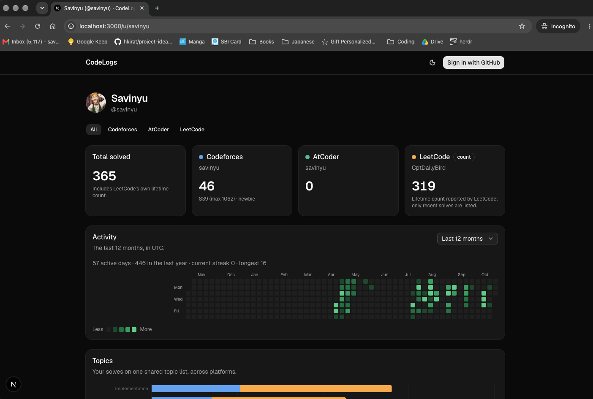

# CodeLogs

One dashboard for your competitive programming and DSA progress across **Codeforces, AtCoder and LeetCode**: totals, an activity heatmap, difficulty and topic breakdowns, your weak topics, and what to solve next.

## The problem

If you practise on more than one site, your progress is split across profiles that don't agree on anything. Codeforces tags a problem `dp`, LeetCode says `dynamic-programming`, AtCoder has no tags at all, and each site has its own difficulty scale. Existing trackers mostly add up totals and ratings. They don't tell you which topics you're behind on.

CodeLogs maps every platform's tags onto **one topic list** (10 topics, 40 subtopics), scores how well each topic is covered against what someone at your level would be expected to have solved, and recommends **unsolved** problems at the right difficulty for your weakest topics. A public profile page (`/u/<github-username>`) works as a shareable portfolio.



## Features

- **Connect handles** for Codeforces, AtCoder and LeetCode. Handles are checked against the platform when you add them.
- **Background sync** of solved problems, incremental after the first run, plus a daily refresh of every active account.
- **Dashboard:** totals per platform, an activity heatmap (last 12 months or any year you were active), a difficulty chart on a shared 5-band scale, platform tags with "gaps" (popular tags you haven't touched), and recent solves with Easy / Medium / Hard tags.
- **Topics:** coverage per shared topic, weak-topic scoring, and "Solve next" picks (Codeforces problems rated +100–200 above your level, plus free LeetCode problems).
- **Public profile:** opt-in, read-only, with an Open Graph preview image. Only handles you've **verified** (by pasting a short code into your platform profile) appear on it.
- **Full LeetCode history:** upload the JSON that `leetcode.com/api/problems/all/` gives you while logged in. Only the list of solved problem slugs is sent; your cookies never leave the browser.
- **Browser extension** (`extension/`, Chrome MV3): does the same from your logged-in browser in one click, and can add solve dates from your submission list. It authenticates with a personal token from Settings and sends only problem slugs and dates; never cookies or code.
- **Contests and badges:** Codeforces and LeetCode contest history on one rating-over-time chart, with contests entered, current and max rating, best rank, and LeetCode's global rank and Knight / Guardian badge. Your LeetCode badges show as a strip of icons.
- **Sheets:** progress through Blind 75 and NeetCode 150, by section and difficulty (problem list from [NeetCode](https://github.com/neetcode-gh/leetcode), MIT).
- **Social links:** add X, Instagram, a website and an email in Settings. They show as icons, next to your GitHub, on your dashboard and public profile.
- **Your data:** export everything as JSON, or delete your account, from Settings.

## Architecture

```
Browser ──> Next.js (pages, server actions, route handlers) ──────────> Postgres (Neon)
               │  "Sync now", new handle                                     ▲
               └─ inngest.send("account/sync") ──┐                           │
                                                 ▼                           │
Inngest ── webhook ──> /api/inngest   (each step is its own short invocation) │
   ├─ syncAccount         one step per page: fetch → write → sleep(rate limit) ┤
   ├─ syncStaleAccounts   cron 04:00 UTC: queue accounts not synced for 20 h  │
   ├─ syncCatalogs        cron 03:00 UTC: CF + AtCoder daily, LeetCode Sundays│
   └─ syncCatalog         refresh one platform's problem catalog ─────────────┘
                                                 │
                     adapters (codeforces | atcoder | leetcode) → platform APIs
```

- **Adapters** (`lib/adapters/`) are pure: HTTP in, normalized solves out. They never touch the database, so their tests run offline against saved API responses in `fixtures/`. All requests go through one fetch wrapper with timeouts, retries with backoff, and per-host pacing (Codeforces 2 s, AtCoder 1.1 s, LeetCode 1 s).
- **Sync** (`lib/sync/`, `lib/inngest/`) runs on Inngest. Every page fetch and its database write is one step, so no single serverless invocation runs long, and a retry repeats only that page. Writes are idempotent (`ON CONFLICT DO NOTHING`, change-only upserts), and each account keeps a cursor so later syncs only read newer submissions.
- **Catalogs** (every problem on each platform, with tags and difficulty) are refreshed by a separate cron, not by user syncs.
- **Topics** (`lib/topics/`): a two-level taxonomy, Codeforces and LeetCode tag mappings, coverage scoring, and recommendations. All pure and unit-tested except the database reads.
- **Dashboard** (`lib/dashboard/`): user-scoped queries feed pure aggregation code, rendered by server components with Recharts charts and a custom SVG heatmap.

**Stack:** Next.js 16 (App Router, Cache Components), React 19, TypeScript, Tailwind 4 + shadcn/ui (Base UI), Drizzle ORM on Neon Postgres, Better Auth (GitHub login), Inngest, Vitest.

## Data limits

Each platform exposes different data, and the dashboard labels where numbers come from.

| Platform | Source | What we get | Limits |
|---|---|---|---|
| Codeforces | Official API | Every accepted submission, with problem tags and ratings | Some problems are missing from the public catalog; they're kept from the submission's own data |
| AtCoder | [AtCoder Problems](https://github.com/kenkoooo/AtCoderProblems) (unofficial) | Every accepted submission, with estimated difficulty | **No topic tags** anywhere, so AtCoder doesn't count toward topics. Difficulty is a model estimate |
| LeetCode | Public GraphQL (unofficial) | Lifetime counts by difficulty and tag, the activity calendar, and the **20 most recent** accepted solves | The full solved list is private. Marked "partial" until you import the full list; after that, sync at least once every 20 solves (the daily refresh does this) to keep it complete |

Other things to know:
- **LeetCode topic numbers are estimates.** They come from LeetCode's lifetime per-tag counts, which overlap, and LeetCode only counts 47 broad tags per user.
- **Activity mixes units:** Codeforces and AtCoder days count new problems solved; LeetCode days count submissions (that's what its calendar reports).
- **Difficulty bands are our own** cross-platform approximation (e.g. Band 3 ≈ CF 1400–1600 ≈ AtCoder 600–899 ≈ LeetCode Medium), not an official conversion.
- **No AtCoder contest history:** the only source, `atcoder.jp/users/<you>/history`, is disallowed by AtCoder's robots.txt.
- **Imported LeetCode solves have no dates**, so they count toward totals and topics but not the heatmap.
- HackerRank, CodeChef and GeeksforGeeks aren't supported: their terms or robots.txt rule out server-side access. CodeLogs never asks for platform passwords or cookies.

## Running locally

Needs Node 24+, pnpm, a Neon (or any Postgres) database, and a GitHub OAuth app with the callback `http://localhost:3000/api/auth/callback/github`.

```bash
pnpm install
cp .env.example .env.local     # fill in the values
pnpm db:migrate
pnpm dev                       # http://localhost:3000
pnpm inngest:dev               # second terminal: Inngest dev server on http://localhost:8288
```

Run a catalog sync once from the Inngest dev server (send `catalog/sync` with `{"platform": "codeforces"}`, and the same for `atcoder` and `leetcode`) so problems have titles, tags and difficulty.

Checks (CI runs the same): `pnpm typecheck && pnpm lint && pnpm format:check && pnpm test`.

## Status

A side project. See [`PLAN.md`](PLAN.md) for decisions, milestones and progress, and [`scripts/spike/FINDINGS.md`](scripts/spike/FINDINGS.md) for what each platform's API actually returns.
